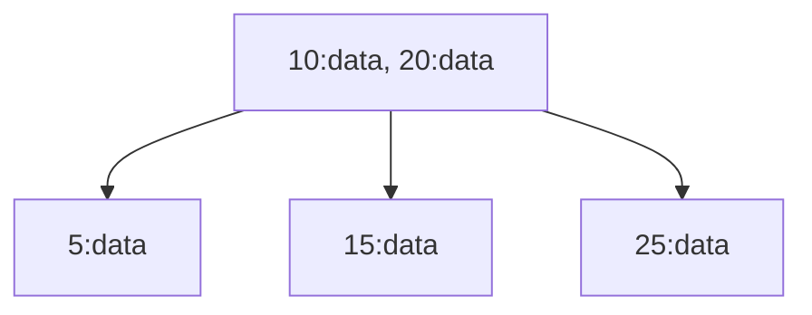
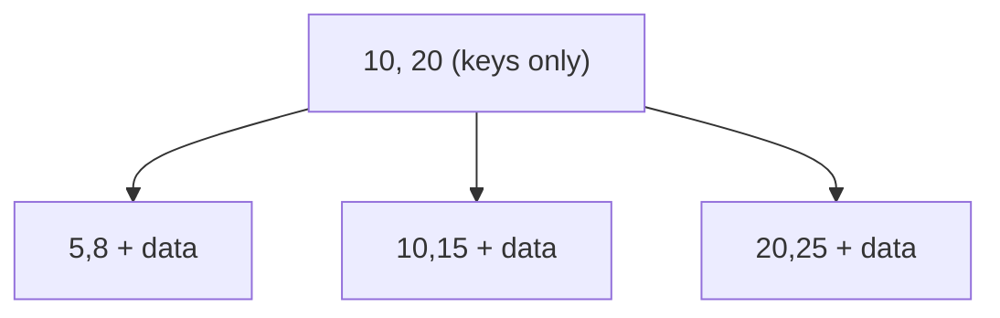

# B Tree

> A general concept. MySQL (InnoDB), PostgreSQL, SQL Server and SQLite all use the B+ Tree for indexes.

Almost every index in a DB is a B+ Tree. Finding one row takes only 3–4 disk IOs, whether the table holds ten thousand rows or a hundred million.

## The problem with a Binary Search Tree on disk

A BST (Binary Search Tree) stores one entry (key + value) per node; keys on the left are smaller, keys on the right are larger. A lookup walks down from the root and rules out half the tree at each level, O(log₂N).

```text
BST: one entry per node
        8:data
       /     \
     3:data  10:data
     /  \       \
  1:data 6:data 14:data
```

Problem one: insert 1, 2, 3, 4, 5 in order and the BST leans into a straight line, degrading to O(n). The **AVL Tree** and **Red-Black Tree** solve this: BSTs that balance themselves, rotating after each insert so the tree never leans.

Problem two: even balanced, **each node still holds only one entry**. For a hundred million rows the tree is log₂(100 million) ≈ 27 levels tall. In memory, 27 levels is fine. But a DB index lives on disk, and each level costs one disk IO. One disk seek is about 10ms, so 27 of them is 270ms. Too slow.

## B+ Tree: hundreds of entries per node

Each B+ Tree node is a whole page (usually 16KB), and one page holds hundreds of entries.

B+ Tree nodes come in two kinds:

```text
Internal page → stores only keys, used to navigate "go left or go right"
Leaf page     → stores key + data, the real data lives here

            [50, 100]              ← Internal page: keys only
           /    |     \
[rows 1..49] [50..99] [100..150]  ← Leaf page: key + full row data
```

A BST node corresponds to **one entry** inside a leaf page, not a whole page. One leaf page holds tens to hundreds of rows.

```text
BST: one entry per node → 100 million rows, 27 levels, 27 disk IOs
B+ Tree: hundreds of entries per node → 100 million rows, 3-4 levels, 3-4 disk IOs
```

From 27 down to 3-4. That is why DBs use the B+ Tree and not AVL / RBTree. AVL and RBTree suit data structures in memory; the B+ Tree suits an index on disk.

## Why 3-4 levels: a sense of scale

"3-4 IOs for a hundred million rows" comes from this arithmetic:

1. **Page size = 16 KB** (each node is one page)
2. **Each internal node entry ≈ 14 bytes** (key 8B + pointer 6B) → one page holds ~1000 entries → **fan-out ≈ 1000**
3. **Each leaf page row ≈ 100~200 bytes** → one leaf holds ~100 rows

Internal and leaf pages play **completely different roles**:

- An **internal page** stores only navigation (key + pointer). Entries are small, so fan-out is large
- A **leaf page** stores whole rows. Entries are much larger, so a leaf stops at ~100 rows

The "multiply by 1000 going down" only happens at internal levels. The leaf is the end; it does not expand further.

```text
Level 0 (root):                  1 page
                                  ↓ expand ×1000
Level 1 (internal):          1,000 pages
                                  ↓ each expands ×1000
Level 2 (internal):      1,000,000 pages
                                  ↓ each expands ×1000
Level 3 (leaf):      1,000,000,000 pages
                                  ↓ 100 rows per leaf
Total:              100,000,000,000 rows (100 billion)
```

Capacity formula: `N ≈ 1000^(internal levels) × 100`

| Tree depth (including leaf) | Capacity |
|---|---|
| 2 levels | 100 thousand |
| 3 levels | 100 million |
| 4 levels | 100 billion |

A hundred million rows need only 3 levels; it takes a hundred billion to need 4. "3-4 IOs for a few hundred million rows" is already a generous estimate.

### Compared with BST: the difference is the base of the logarithm

```text
BST (fan-out 2):   log₂(100M)    ≈ 27 levels → 27 disk IOs
B+ Tree (1000):    log₁₀₀₀(100M) ≈  3 levels →  3 disk IOs
```

One disk seek is about 10ms. 27 seeks = 270ms, 3 seeks = 30ms. Fan-out can reach 1000 because internal nodes store keys without data; the entries are small enough that a page fits 1000 of them.

### The effect of fat rows

What happens when a row is large (say 2KB)?

- Rows per leaf drop from 100 to 8 (16KB / 2KB)
- Internal node fan-out is unaffected (internal nodes store only keys)

```text
Depth 4: 1 → 1000 → 1M → 1B leaves × 8 rows ≈ 8 billion rows
```

Capacity falls to 1/12 of before, but the conclusion "3-4 levels cover billions of rows" still holds. When designing a table, store TEXT / BLOB elsewhere and keep only a pointer in the main table. Each row gets smaller, a leaf holds more of them, the same row count may need one level less, and every lookup saves one IO.

## B Tree vs B+ Tree

**B Tree**: every node stores key + data.



**B+ Tree**: internal nodes store only keys, all data is in the leaves. Leaves are chained into a linked list with pointers, which supports range queries.



The B+ Tree advantage: internal nodes hold no data, so a page fits more keys, the tree is shorter, and there are fewer IOs. Leaf nodes are linked by pointers, so a range query (`WHERE id BETWEEN 10 AND 50`) just scans along the linked list without going back to the root.

Every mainstream RDBMS (MySQL InnoDB, PostgreSQL, SQL Server) uses the B+ Tree. When people say "B-Tree index", they mean a B+ Tree.

## Writes: page split

An INSERT walks the B+ Tree to the matching leaf page and puts the row in. If the leaf page is full, it splits into two pages (page split), and the parent node gets one more key pointing at the new page.

The cost of a page split: one write may become several (the leaf once, the parent once, and if the parent is also full the split chains upward). Random writes are also hard to avoid, because an INSERT into a middle leaf needs random IO; a UUID PK suffers the most (see [clustered-index](chunk://clustered-index)).

The structure that goes the other way, sacrificing reads for write speed, is the [lsm-tree](chunk://lsm-tree).
