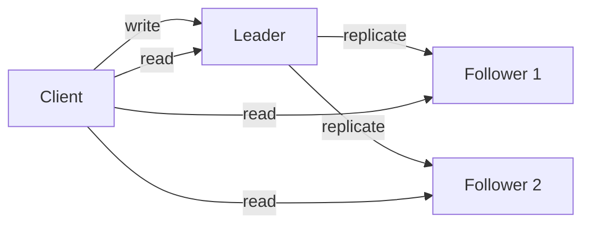
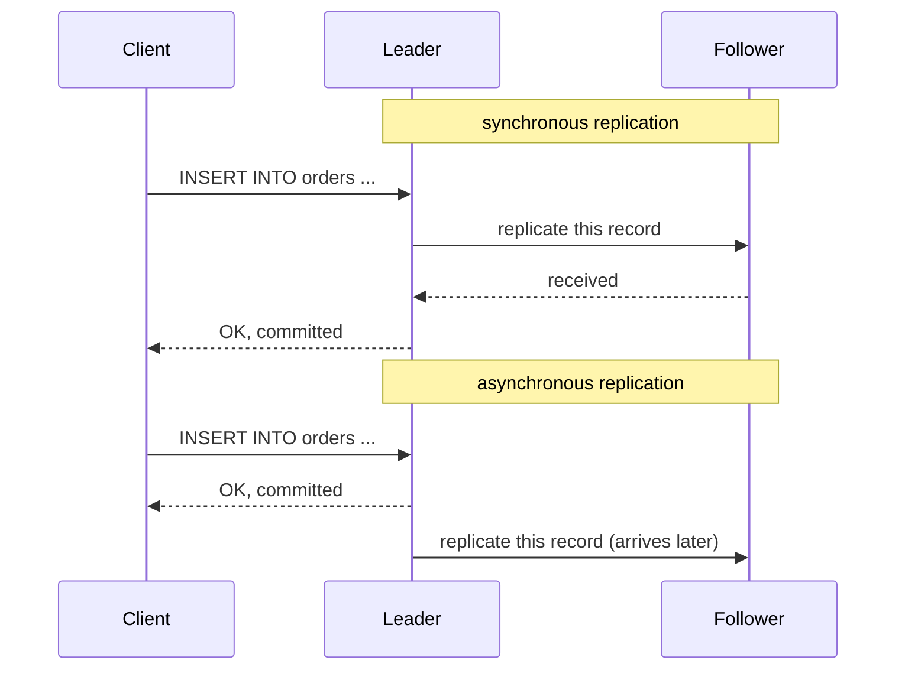
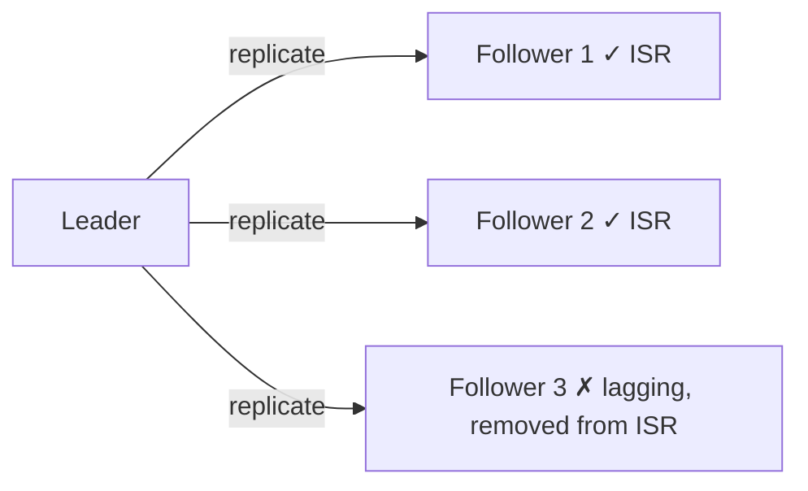

# Replication

> A general concept. MySQL, PostgreSQL, MongoDB and Kafka all have replication. The leader-follower architecture is general; the ISR mechanism is specific to Kafka.

The same data is copied to multiple nodes. When one goes down, the others can still serve.

## Leader-Follower

The most common architecture. One leader (also called primary / master) handles all writes. Followers (also called replica / slave) copy data from the leader and accept reads only. Kafka uses this architecture too: each partition has one leader, and the other brokers act as followers.

What if the leader goes down? The followers vote and elect a new leader (failover). No writes are possible during the election.

## Sync vs async replication

**Synchronous**: the leader waits for the follower to confirm receipt before replying to the client. No data is lost, but it is slow. One stuck follower stalls every write.

**Asynchronous**: the leader replies to the client as soon as its own write is done, and the follower catches up later. Fast, but if the leader goes down, the most recent writes may be lost (the follower has not received them yet).

## Kafka's ISR (In-Sync Replicas)

ISR is a compromise: do not wait for every follower, only for the ones that keep up.

Each partition has one leader and several followers. The ISR is the list of followers that are currently keeping up with the leader. Kafka uses `replica.lag.time.max.ms` (default 30 seconds) to decide: if a follower has gone more than 30 seconds without catching up to the leader's latest data, it is removed from the ISR.

A removed follower is not deleted. It keeps pulling data from the leader to catch up. Once it has caught up (lag back within the threshold), it rejoins the ISR automatically.

When producing, the `acks` parameter controls who the producer waits for:

| acks | Behavior | Trade-off |
|---|---|---|
| `0` | Wait for no one | Fastest, may lose data |
| `1` | Wait for the leader's write only | May lose data if the leader goes down |
| `all` | Wait for every ISR member to confirm | Safest, slowest |

`acks=all` together with `min.insync.replicas=2`: a write is accepted only when at least 2 ISR members exist. If the ISR has shrunk to the leader alone, writes are rejected (giving up availability to protect the data).
